# Mobile screens

A first pass at Pirsig on a phone: the desktop app's views, reshaped for one hand. The
sidebar becomes a tab bar (Today, Notes, Slip-box, PARA, More) and quick capture becomes a
sheet. Colours, kinds and words come from the desktop app (`desktop/dist/app.css` and the
views in `desktop/dist/js/views/`), so the two read as one app.

The screens were drawn in [OpenPencil](https://github.com/open-pencil/open-pencil) through
its MCP server, at 390×844 and exported at 2×. They are mock-ups with sample data; the
[app built from them](#the-app) follows.

| Today | Notes | Note |
|---|---|---|
|  | 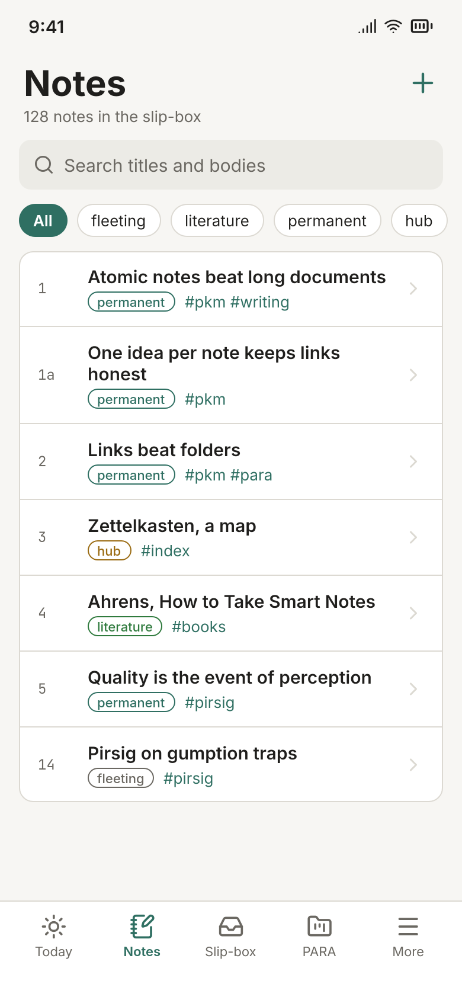 |  |

| Slip-box | Project | Capture |
|---|---|---|
| 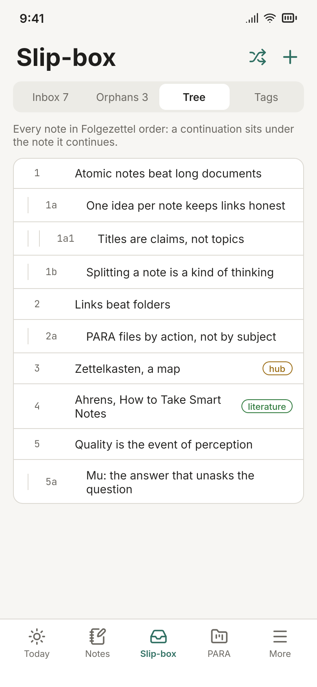 | 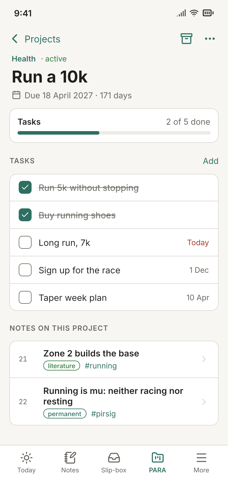 | 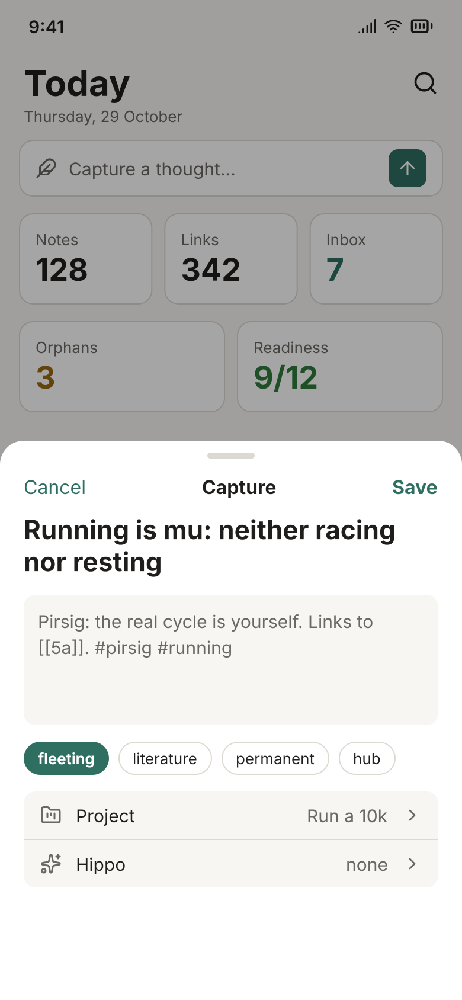 |

## The app

`crates/pirsig-mobile` builds these screens in Rust (Leptos, compiled to WebAssembly), and
the Android app opens them at `/mobile/`. Its colours and icons are exported from the design
file, `docs/design/pirsig-mobile.fig`, and its sizes are read from the frames' auto-layout;
`desktop/README.md` says how. Below, each frame beside a screenshot of the app: Chromium at
390×844 and 2× (Android's WebView is Chromium), on a brain seeded with the design's notes,
projects and tasks.

| Screen | Design | App |
|---|---|---|
| Today |  | 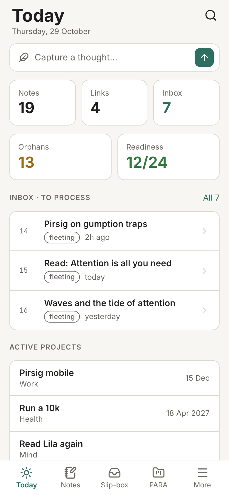 |
| Notes |  | 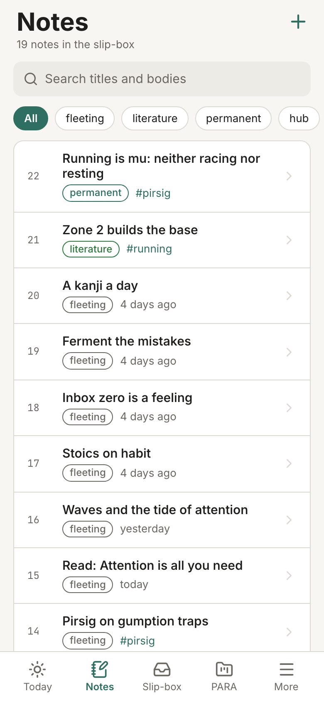 |
| Note |  | 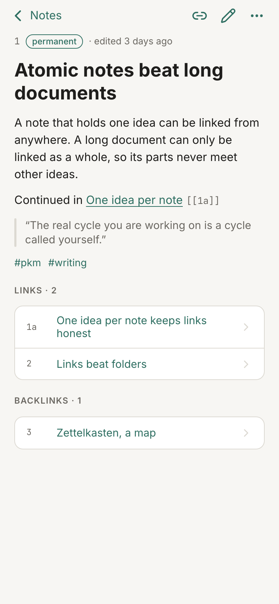 |
| Slip-box |  | 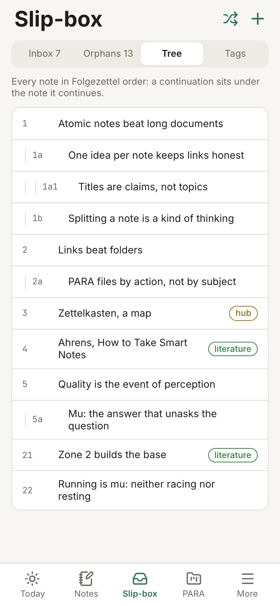 |
| Project |  | 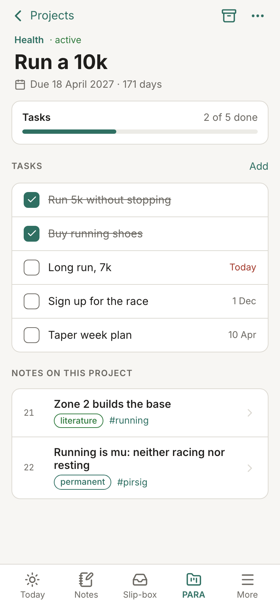 |
| Capture |  | 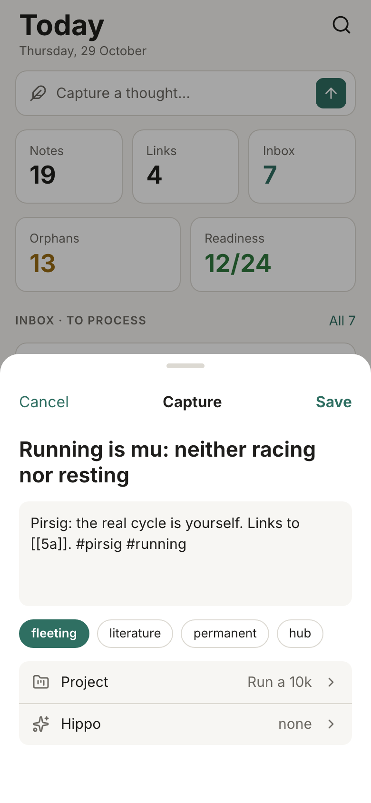 |

Where the app differs:
- The counts are the seeded brain's (19 notes, not 128).
- Notes lists the newest first, as the API pages them; Today lists projects by due date.
- Rows are at least 44px tall, so a thumb can hit them.

In dark mode, the app follows the phone's theme:

| Today | Notes | Note |
|---|---|---|
| 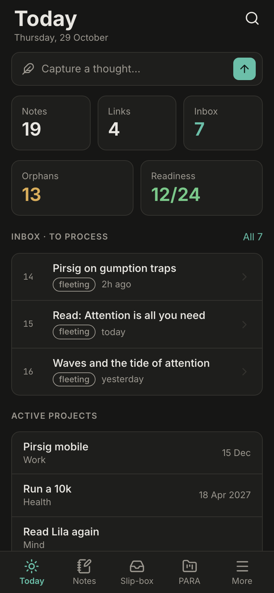 | 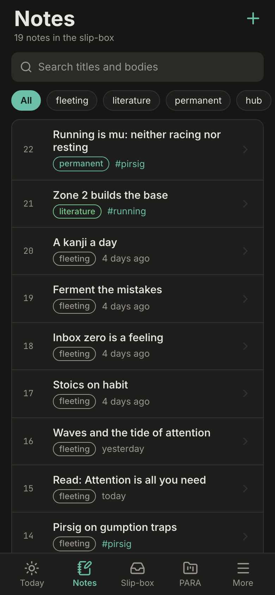 | 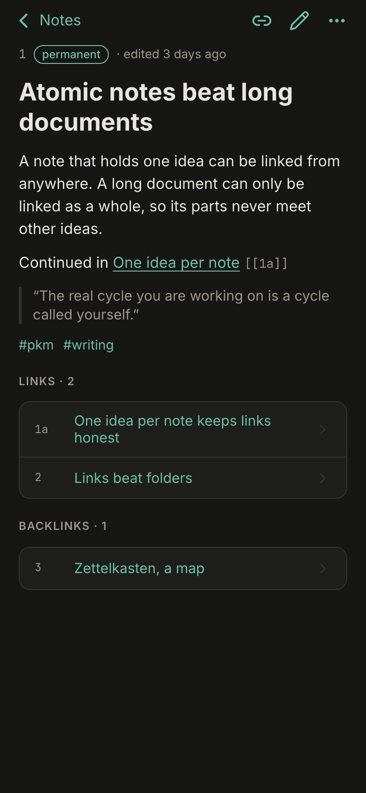 |

What the screens map to:

| Screen | Desktop view | API |
|---|---|---|
| Today | `#/` (`today.js`) | `/api/slipbox/stats`, `/api/readiness`, `/api/slipbox/inbox`, `/api/projects`, `/api/tasks` |
| Notes | `#/notes` | `/api/notes` |
| Note | `#/notes/:zid` | `/api/notes/:zid` |
| Slip-box | `#/slipbox/:tab` | `/api/slipbox/{inbox,orphans,tree}`, `/api/slipbox/stats` |
| Project | `#/projects/:id` | `/api/projects/:id`, `/api/projects/:id/notes`, `/api/tasks` |
| Capture | the sidebar's capture form | `POST /api/notes` |

Not drawn yet: Hippos, Areas, Resources, Feeds and arXiv, Plasticity, Readiness, the note
editor, and dark mode (the app has a dark theme, from the design's Dark variables).
